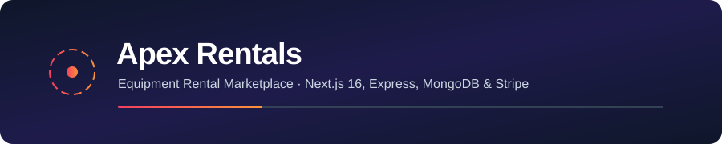
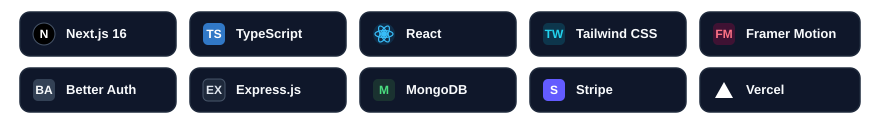

<div align="center">



`Next.js 16` • `TypeScript` • `Tailwind CSS` • `Framer Motion` • `Better Auth` • `MongoDB` • `Stripe`

</div>

---

## About

**Apex Rentals** connects renters with verified equipment owners across Bangladesh. Anyone can browse available listings by category and rental term, customers can book equipment and pay online through Stripe, owners can list and track their fleet, and admins can manage platform-wide listings, rentals, and users.

This repository contains the **client** (frontend) of the project.

## Features

- 🔍 **Equipment Catalog:** browse all approved equipment with category filters, search, and availability badges, and open canonical slug-based detail pages (`/equipment/[id]`)
- 💳 **Booking & Stripe Checkout:** select start and end dates, rental duration (`Daily`, `Weekly`, `Monthly`), and unit quantities with real-time total calculation, then pay via Stripe Checkout (`/payment/success`)
- ❤️ **Favorites & Customer Rentals:** customer accounts can save listings to their favorites list and track active or past bookings on My Rentals
- 🛠️ **Owner Fleet Management:** owners can publish new equipment with imgbb image uploads, update or remove their listings, and monitor incoming rentals on Owner Rentals
- 🛡️ **Admin Moderation & Analytics:** admins can approve or manage all equipment, oversee all platform rentals, manage user roles, and inspect revenue and rental charts
- 🔐 **Secure Authentication:** email/password and Google OAuth sign in and sign up powered by Better Auth with role-based dashboard routes

### Equipment Categories

`Construction Equipment` · `Photography Equipment` · `Vehicles & Transportation` · `Agriculture Equipment` · `Electronics` · `Event Equipment`

## Tech Stack

<div>



</div>

| Layer | Technologies |
| :--- | :--- |
| **Framework** | Next.js 16 (App Router) & TypeScript |
| **Styling & UI** | Tailwind CSS, shadcn/ui, Framer Motion, Lucide React |
| **Authentication** | Better Auth |
| **Backend & Database** | Express.js & MongoDB |
| **Payments & Media** | Stripe Checkout & imgbb |
| **Alerts & Charts** | Sonner & Recharts |
| **Deployment** | Vercel |

## Getting Started

**1. Clone the repository**

```bash
git clone [https://github.com/Ayman392/apex-rentals.git](https://github.com/Ayman392/apex-rentals.git)
cd apex-rentals
```

**2. Install dependencies**

```bash
npm install
```

**3. Set up environment variables**

Create a `.env.local` file in the project root (or copy `.env.example`) and add your own values:

```env
NEXT_PUBLIC_API_URL=http://localhost:5000
BETTER_AUTH_SECRET=your_secret
BETTER_AUTH_URL=http://localhost:3000
NEXT_PUBLIC_APP_URL=http://localhost:3000
MONGODB_URI=your_mongodb_connection_string
MONGODB_DB_NAME=apex_rentals
GOOGLE_CLIENT_ID=your_google_client_id
GOOGLE_CLIENT_SECRET=your_google_client_secret
NEXT_PUBLIC_IMGBB_API_KEY=your_imgbb_api_key
NEXT_PUBLIC_STRIPE_PUBLISHABLE_KEY=your_stripe_publishable_key
```

**4. Run the development server**

```bash
npm run dev
```

Open [http://localhost:3000](http://localhost:3000) in your browser.

## Project Structure

```text
├── app/             # Next.js routes, API auth handler, equipment & role dashboards
├── components/      # Reusable UI primitives, Home sections, Navbar & Footer
├── hooks/           # Custom React hooks
├── lib/             # API helpers, Better Auth setup, imgbb, slug & constants
├── public/          # Static assets, logo & README SVGs
├── components.json  # shadcn/ui configuration
├── next.config.ts
└── package.json
```

## Scripts

| Command | Description |
| :--- | :--- |
| `npm run dev` | Start the development server |
| `npm run build` | Create a production build |
| `npm run start` | Run the production build |
| `npm run lint` | Check the code with ESLint |

## Author

<div align="center">

**Made by [Ayman](https://github.com/Ayman392)**


</div>
