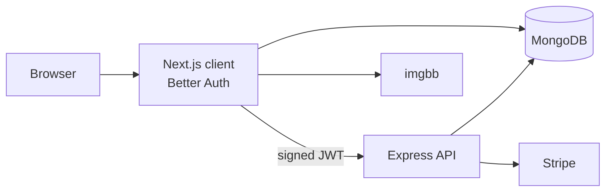

<div align="center">



<br />

**[Live site](https://apex-rentals-psi.vercel.app)** &nbsp;·&nbsp; **[Server repository](https://github.com/Ayman392/Apex-Rentals-server)**

</div>

## Overview

Apex Rentals is an equipment rental marketplace. Owners list equipment, customers book it for a date range and pay through Stripe, and admins approve listings and watch how the platform is doing. Listings fall into six categories: construction, photography, vehicles, agriculture, electronics and event equipment.

This repository is the Next.js client. It talks to a separate Express API, [Apex-Rentals-server](https://github.com/Ayman392/Apex-Rentals-server), which owns the equipment, rental and payment data in MongoDB and checks user roles on every protected request.

- **Live URL:** https://apex-rentals-psi.vercel.app
- **Client repository:** https://github.com/Ayman392/Apex-Rentals
- **Server repository:** https://github.com/Ayman392/Apex-Rentals-server

## Features

**Everyone**

- A home page with a hero, featured equipment, categories, how it works, why choose us and customer reviews
- An equipment listing with search by name or location, filters for category, rental type, price range and availability, sorting, and pagination. All of it runs on the server, not in the browser
- Light and dark themes, remembered between visits

**Customers**

- Equipment details with owner information, rental terms and remaining stock
- Favorites, saved in the database
- Booking with a start date, end date and quantity, an automatic total, and payment through Stripe Checkout
- A My Rentals table with payment and booking status, and an editable profile

**Owners**

- Add equipment with a photo upload to imgbb. New listings start as pending until an admin approves them
- Edit or delete your own listings
- See the rentals booked on your equipment, with charts for rentals and earnings

**Admins**

- Approve, reject, edit or delete any listing
- Change a user's role between customer, owner and admin
- Review every rental on the platform
- Platform charts for users, equipment, bookings and revenue

**Accounts and access**

- Email and password sign-up (at least 6 characters with an uppercase and a lowercase letter), plus Google and GitHub sign-in
- New accounts start as customers. Dashboard routes are limited by role
- Sessions are handled by Better Auth, and the API verifies the signed token it issues before serving protected data

## How it fits together



## Tech stack



The client uses Next.js 16 with the App Router, React 19 and Tailwind CSS 4. Equipment and profile photos are uploaded to imgbb. The Express API lives in its own [repository](https://github.com/Ayman392/Apex-Rentals-server).

## npm packages

| Purpose | Packages |
| :-- | :-- |
| Framework | `next`, `react`, `react-dom` |
| Authentication and data | `better-auth`, `mongodb` |
| Payments | `stripe` |
| UI components | `shadcn`, `@base-ui/react`, `class-variance-authority`, `clsx`, `tailwind-merge`, `cmdk`, `embla-carousel-react`, `input-otp`, `react-day-picker`, `react-resizable-panels`, `shiki` |
| Icons, toasts, themes | `lucide-react`, `sonner`, `next-themes` |
| Animation and scrolling | `framer-motion`, `lenis`, `react-use-measure`, `tw-animate-css` |
| Charts and dates | `recharts`, `date-fns` |
| Build tooling (dev) | `typescript`, `tailwindcss`, `@tailwindcss/postcss`, `eslint`, `eslint-config-next`, `@types/node`, `@types/react`, `@types/react-dom` |

## Getting started

You need Node.js 20 or newer, a MongoDB database, and the [server](https://github.com/Ayman392/Apex-Rentals-server) running locally.

```bash
git clone https://github.com/Ayman392/Apex-Rentals.git
cd Apex-Rentals
npm install
```

Copy `.env.example` to `.env.local` and fill in your own values:

| Variable | What it is for |
| :-- | :-- |
| `NEXT_PUBLIC_API_URL` | Base URL of the Express API, for example `http://localhost:5000` |
| `NEXT_PUBLIC_APP_URL` | Public URL of this app |
| `BETTER_AUTH_URL` | Base URL Better Auth uses, usually the same as the app URL |
| `BETTER_AUTH_SECRET` | Long random string used by Better Auth |
| `MONGODB_URI` | MongoDB connection string |
| `MONGODB_DB_NAME` | Database name |
| `GOOGLE_CLIENT_ID`, `GOOGLE_CLIENT_SECRET` | Google OAuth credentials |
| `GITHUB_CLIENT_ID`, `GITHUB_CLIENT_SECRET` | GitHub OAuth credentials |
| `NEXT_PUBLIC_IMGBB_API_KEY` | imgbb key for equipment and profile photos |
| `NEXT_PUBLIC_STRIPE_PUBLISHABLE_KEY` | Stripe publishable key |

Then start the development server:

```bash
npm run dev
```

Open http://localhost:3000. Secrets stay in `.env.local`, which is ignored by git.

## Scripts

| Command | What it does |
| :-- | :-- |
| `npm run dev` | Start the development server |
| `npm run build` | Create a production build |
| `npm run start` | Serve the production build |
| `npm run lint` | Run ESLint |

## Project structure

```text
app/
  equipment/            listing and [id] details pages
  login/  register/     authentication pages
  payment/success/      Stripe return page
  dashboard/            customer, owner and admin pages
components/
  Home/                 home page sections
  Shared/               motion helpers, section heading, X logo
  ui/                   shadcn components
hooks/                  custom React hooks
lib/                    API helpers, Better Auth setup, constants
docs/                   README assets
```

## Deployment

The client is deployed on Vercel. Every variable in the table above has to be set in the Vercel project settings, and the production URL must be listed as a trusted origin in the Better Auth config in `lib/auth.ts`.

---

<div align="center">


Built by [Ayman](https://github.com/Ayman392)

</div>
